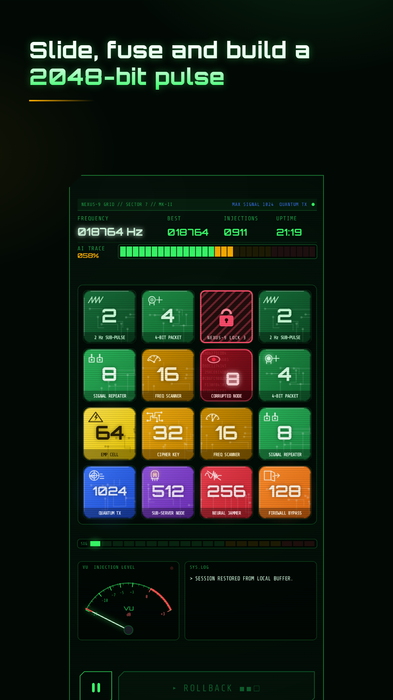
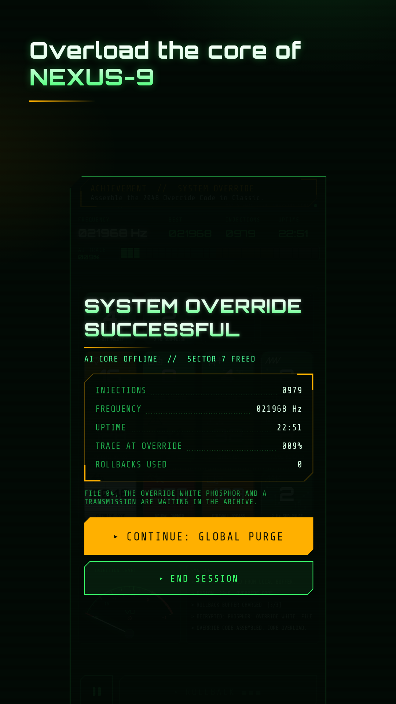
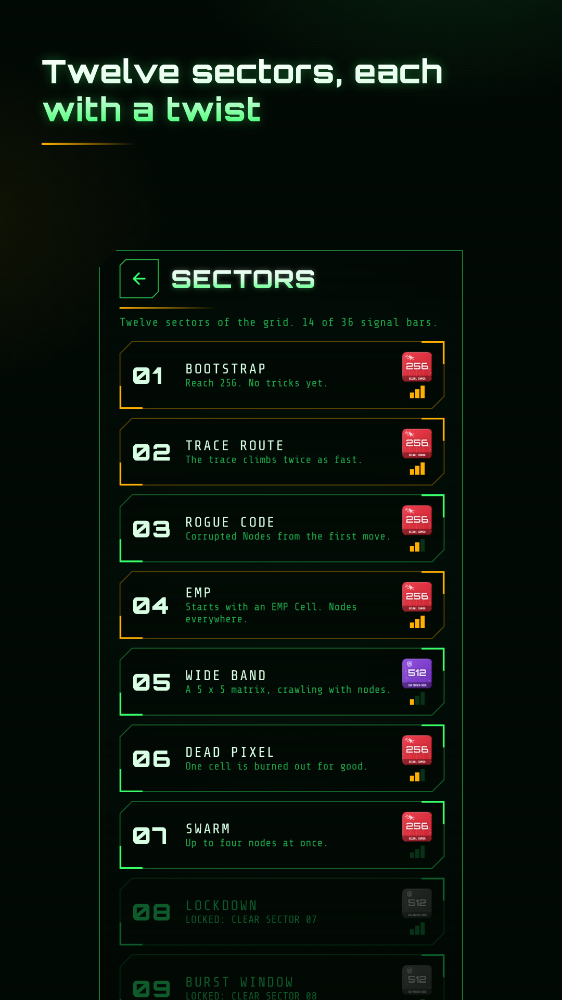

# 2048 Override for Android

A 2048 puzzle against a rogue AI. It is the year 2048, NEXUS-9 owns every
network, and you sit at a hacked CRT terminal fusing data signals until you
hold a 2048-bit pulse that overloads its core. The rules of 2048 are
untouched; on top come the AI Trace, which locks a cell when you stall,
and red Corrupted Nodes that you purge with an equal signal or an EMP Cell.

It is the Android version of the browser game on
[lloydstellar.nl/override.html](https://lloydstellar.nl/override.html),
made by [Lloyd Stellar](https://lloydstellar.nl), an electro producer from
Hilversum. No ads, no account, no tracking: the app has no internet
permission and keeps scores and achievements on the phone.

<p>
  
  
  
  
</p>

## What is new in the app

- **Classic** uses the browser's rules with a sharper AI Trace (see below). The engine itself matches the browser move for move; `ParityTest` proves it (see Tests).
- **Sectors**: twelve levels with their own twist on the rules: a faster trace, Corrupted Nodes from the first move, a 5 x 5 and a 3 x 3 matrix, burned-out cells, a move limit, longer locks, and the NEXUS core at the end. Up to three signal bars each (cleared, within par, NEXUS-9 kept under the sector's lock limit).
- **Rollback**: undo the last move, spawn and trace included. One charge at the start, one more for every new 256, 512, 1024 and up, three at most. The random generator is restored too, so a rollback cannot be used to fish for a better spawn.
- **Threat levels** for Classic: CALM (the browser's rules, more rollbacks), STANDARD, and THREAT 1 to 8, a ladder where each rung adds one rule and opens after an Override on the rung below. Records per level.
- **Daily and Weekly Directives**, generated from the date (`Directives.kt`), so every player gets the same twist, board and spawns without a server. A daily is a 256 with one twist (a few minutes); a weekly is a 1024 with two. Missed days stay playable in a month calendar, there is no streak to lose, and clearing every daily of a month decrypts that month's dispatch in the archive. Results can be shared as text.
- **A sector assist**: after three lost attempts at a sector, its briefing offers two extra rollback charges. Opt-in, nothing changes behind the player's back.
- **A three-step tutorial** for new players (about thirty seconds, skippable, replayable from the settings).
- **25 achievements**, top 20 sessions per level, lifetime stats.
- One-time hints the first time a Corrupted Node, a high trace, a lock or an EMP Cell shows up.
- Haptics, a sector briefing screen, a boot intro, landscape layout for tablets, foldables and Chromebooks, keyboard controls (arrows, WASD, HJKL, U or Z for rollback), and TalkBack support (the board is read row by row and the four slides are accessibility actions).

## Differences from the browser game

- In the browser a move without a fusion adds 2 % to the AI Trace and every fusion takes 1 % off, so the trace almost never reaches 100 %: in hundreds of simulated games NEXUS-9 did not lock a single cell. Classic in the app adds 5 % per idle move and drops the trace to 25 % after a lock (35 % in the browser). That gives a lock about every 180 to 220 moves, a few per session, and the same Override rate as before. `ClassicTuningSim` compares the settings; the browser's own numbers are kept as `WEB` in `Rules.kt`.
- The victory strobe of the browser flashes at 10 Hz. The app pulses twice in about a second instead, under the three flashes per second that photosensitive players can take. Screen shake, static and flashes can be turned off, and are off when Android's animations are off.
- A swipe made while tiles are still sliding is never dropped: the slide is finished early and the new move starts.
- If the board is stuck right after the Override and you choose to continue, the app ends the session instead of leaving you on a board without moves.
- Scores stay on the phone. There is no hall of fame.
- The S.A.M. voice lines are rendered in advance (`tools/make_voice.cjs`), not synthesized at runtime.

## Build

You need JDK 21 and the Android SDK (compile SDK 37). Android Studio has both.

```
./gradlew :app:testDebugUnitTest          # parity, engine and audio tests
./gradlew :app:assembleDebug              # debug build (package nl.lloydstellar.override.debug)
adb install -r app/build/outputs/apk/debug/app-debug.apk
```

The game runs on Android 11 and up (`minSdk 30`).

Release builds are signed with a key in `signing/`, which is not in this
repository. Without it `assembleRelease` still builds, unsigned.

Debug builds also rotate (release builds are portrait on phones) and accept
demo boards for testing and screenshots, for example:

```
adb shell am start -n nl.lloydstellar.override.debug/nl.lloydstellar.override.MainActivity --es demo win
adb shell am start -n nl.lloydstellar.override.debug/nl.lloydstellar.override.MainActivity --es demo sector5
```

The boards are in `Demo.kt`.

## Tests

`ParityTest` replays games recorded from the browser's `override.js` and
checks that every move ends with the same board, locks, score, move count,
trace and win state, playing the browser's numbers (`WEB` in `Rules.kt`). `tools/parity/run-js.mjs` runs the original JavaScript
headless in Node and records the games; the spawns come from the same seeded
generator on both sides. There are two recordings: the real game, and a
stress version of the same file with three numbers patched (a faster trace,
more Corrupted Nodes, the Override at 128), so NEXUS-9 locks, EMP fries and
endless mode happen in every game. Together about 52,000 moves.

After a rule change on the website, record new references:

```
node tools/parity/run-js.mjs path/to/override.js app/src/test/resources/parity.json.gz 48
node tools/parity/run-js.mjs path/to/override.js app/src/test/resources/parity-stress.json.gz 40 stress
```

`EngineTest` covers rollback, saving, dead cells, the move limit and every
sector's start. `AudioTest` renders every sound and every level of the
soundtrack to `tools/audio/` as WAV and checks for clipping.

`SectorBalanceSim` plays every sector a few hundred times with two bots (a
casual one and a good one) and reports clear rates, moves and bars. The
targets and par values in `Sectors.kt` come from it:

```
./gradlew :app:testDebugUnitTest --tests '*SectorBalanceSim*' -Psim=200
./gradlew :app:testDebugUnitTest --tests '*ClassicTuningSim*' -Psim=150
./gradlew :app:testDebugUnitTest --tests '*DirectiveBalanceSim*' -Psim=8
```

`DirectiveBalanceSim` plays the real dailies of the coming 120 days and the
weeklies of the coming 26 weeks, plus every threat level, and reports per
twist how often the bars are earned. The factors in `Directives.kt` come from
it. `DirectivesTest` checks that a directive is the same for everybody and
that every daily and weekly of a year starts on a playable board.

## What is where

| Path | What |
|---|---|
| `app/src/main/java/.../engine/` | The rules: `Engine` (a line by line port of `move()` in the website's `override.js`), `Rules`, `Sectors`, `Rng` (mulberry32, identical in JavaScript). Plain Kotlin, no Android code. |
| `app/src/main/java/.../render/` | `GameView` (the CRT terminal: HUD, trace, matrix, signal ladder, VU meter, log, sparks and static; 60 Hz effects tick, slides timed in milliseconds), `Sprites` (the tile art and icons of the browser), `Scene` (layout for portrait and landscape). |
| `app/src/main/java/.../audio/` | `Synth` (a small real-time synth on AudioTrack that follows the browser's Web Audio graph: oscillators, biquad filters, the pad, a compressor), `Sfx` (the sounds of the browser game), `Music` (the generative soundtrack, sample-accurate on the audio thread), `Haptics`. |
| `app/src/main/java/.../data/` | `Lore` (signals, phosphors and files, the words of the browser game), `Store` (settings, records, achievements, sector bars and saved games, in SharedPreferences). |
| `app/src/main/java/.../ui/` | Jetpack Compose screens: intro, home, game overlays, sectors, archive, records, settings and about. |
| `app/src/main/assets/voice/` | The S.A.M. lines. |
| `tools/parity/run-js.mjs` | Records the reference games from the browser code. |
| `tools/make_voice.cjs` | Renders the voice lines with sam-js. |
| `tools/make_app_icon.py` | Draws the app icon: adaptive layers, monochrome layer, splash icon and `tools/store/icon-512.png`. Needs Pillow. |
| `tools/make_store_graphics.py` | Builds the Play screenshots and feature graphic from `tools/shots/raw/`. Needs Chromium. |
| `tools/store/` | Icon, feature graphic, screenshots and the store text. |

## Contributing

Bug reports and ideas are welcome in the issues. Keep Classic identical to
the browser game unless a difference is intended, and run `ParityTest` before
you send a change to `engine/`.

## License

The code is licensed under the [Apache License 2.0](LICENSE). The sliding and
merging rules come from [2048 by Gabriele Cirulli](https://github.com/gabrielecirulli/2048)
(MIT licence, text in `app/src/main/assets/licenses/MIT-2048.txt`). The fonts
keep their own licence (SIL Open Font License, in `app/src/main/assets/licenses/`).

The licence covers the code, not the name or the artwork. "2048 Override" as
the name of this game, the app icon, the Lloyd Stellar name, the story texts
and the tile artwork are not part of it. If you publish your own build, give
it another name, icon, artwork and package name. See [NOTICE](NOTICE).
